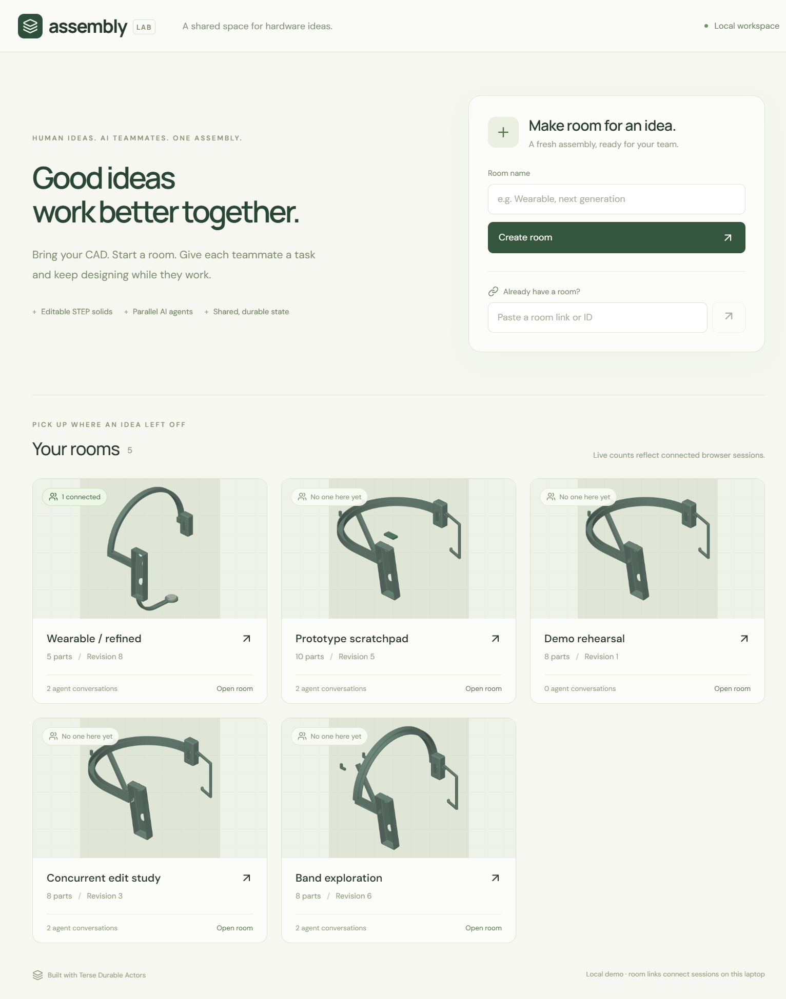
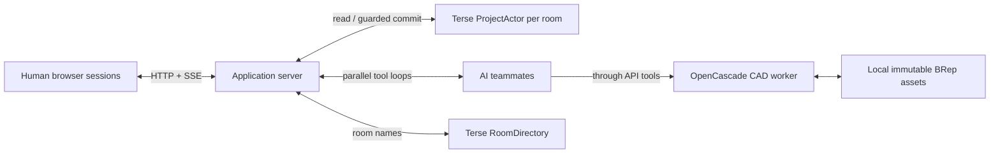

<div align="center">

# assembly

**One assembly. Multiple minds.**

A multiplayer CAD workspace where humans and AI teammates edit real mechanical parts together.

Built at **Haunted Hacks · October 31, 2026** with **Terse Durable Actors** and **OpenCascade**.

[See the example](examples/wearable/README.md) · [How it works](docs/architecture.md) · [Demo script](docs/demo.md) · [Run locally](#run-locally)

</div>



## Why Assembly

Hardware work spans connected parts. Assembly lets you give the band to one AI teammate, the electrode support to another, and continue editing the shared design yourself. Each teammate has a conversation you can return to, with visible **Working**, **Needs reply**, and **Changes saved** states.

Human collaborative CAD already exists. Our focus is bringing parallel AI teammates into that workflow: real geometry tools, shared state, and explicit handling of stale proposals.

## A real prototype, a real result

The example starts with the founder's eight-body wearable STEP assembly. Agents redesigned its rear band into an overhead form, preserved the existing modules, added a submental contact, and refined the initial angular support into a curved arm.


**Download:** [original STEP](examples/wearable/original.step) · [refined STEP](examples/wearable/refined.step) · [actual prompts and responses](examples/wearable/run-notes.json)

This is a recorded model result, including a follow-up refinement. It is not a preset response. The input hardware predates the hackathon; Assembly's application code was written during it.

## What works

| Capability | In the app |
|---|---|
| Shared rooms | Create a room or join by link. Lobby previews use actual saved geometry; counts show connected browser sessions. |
| Editable CAD | Import exact STEP solids, select bodies, move/rotate, edit feature specifications, inspect geometry, undo, and export STEP. |
| Parallel AI teammates | Add named agents, assign tasks, switch conversations, answer questions, and refine accepted designs. |
| Model-visible geometry | Agents inspect topology, measure bodies, view actual renders, and preview candidate edits. |
| Durable collaboration | Terse stores room state and conversations; revision guards reject stale proposals and return them to the model. |
| Programmatic access | The [typed SDK](packages/sdk.ts) uses the same validated API as human and AI edits. |

## How Terse is used



One **ProjectActor per room**, not per component. Parts, revisions, conversations, jobs, and undo live in its durable document. Models reason concurrently outside the actor. The CAD worker validates solids; the actor serializes commits and checks the proposal's base revision. A stale edit returns to the model for revision rather than overwriting accepted work.

The actor handles state ordering. **It does not solve mechanical fit.** Geometry validity and semantic design quality are separate. Details and limits are in [architecture](docs/architecture.md).

## Run locally

Use Linux, macOS, or a Linux checkout inside **WSL 2** on Windows. Install **Bun 1.4.2+** and Git first. Native Windows cannot run the installed Terse local runtime; use WSL for the backend.

```bash
git clone https://github.com/Gravezzz/multiplayer-ai-cad.git
cd multiplayer-ai-cad
bun install
cp .env.example .env
# Optional: set OPENAI_API_KEY, OPENAI_BASE_URL, and OPENAI_MODEL in .env
bun run server
```

In a second terminal, from the same directory:

```bash
bun run dev
```

Open **http://127.0.0.1:5173/**. Create a room, import `examples/wearable/original.step`, and add an agent. Use **Model settings** to connect an OpenAI-compatible Responses endpoint with tool calling and image input. The model name must be available on your account. The hackathon run used `gpt-6.1-sol`.

UI-entered keys live only in server memory and disappear on restart. Bun can load server-side settings from an ignored `.env`. Keys are never returned to the browser or included in the client bundle. There is no automatic provider fallback.

For the original mixed Windows/WSL hackathon checkout, `npm run server:windows` uses the task-local Linux tool binaries. That convenience launcher expects the original workspace layout; new checkouts should use the WSL/Linux steps above and install dependencies inside Linux.

## A quick walkthrough

1. **Create room** or open an existing room card. Each room is an independent persistent document.
2. **Import STEP** once. Import adds bodies; it does not reset a room. Optional STL references are read-only overlays.
3. **Add agent**, name it, and send a task. Add another agent to work concurrently.
4. Select an agent to read its own history or answer a **Needs reply** question. Check **Activity** for accepted changes and conflicts.
5. Select a body to edit it yourself. **Stage** prepares a draft; **Apply change** commits it. **Reset orbit** changes only the camera. **Undo** reverses the last shared geometry edit.
6. **Export STEP** downloads the accepted solids. A second browser session using the same room link receives the same revisions.

[Copy-ready demonstration prompts](docs/demo-prompts.md) · [Agent conversation details](docs/agent-threads.md)

## Evidence and verification

- **Real concurrent model runs:** a recorded stale proposal was rejected, the model reread the assembly, and both independent edits survived. [Evidence](docs/verified-live-runs.json).
- **Real conversation continuation:** a model question produced Needs reply, the answer returned to the same thread, and the exchange survived reload without leaking to another conversation. [Details](docs/agent-threads.md).
- **CAD checks:** eight-body STEP import/export/reimport; source-preserving transforms; unrelated geometry preservation; clipping, booleans, fillet/chamfer, shell, scale, and distance checks.
- **State checks:** stale rejection, request deduplication, targeted edits, thread isolation, actor run admission, shared undo, and a separate actor restart persistence test.

```bash
bun run build
bun run test
bunx tsc --noEmit -p actors/tsconfig.json
bun run test:cad
bunx tsx server/test-operations.ts
bunx tsx server/test-import.ts examples/wearable/original.step
bun run test:integration  # API must be running
```

Some development scripts under `tests/` reference the original live demo rooms; their prerequisites are documented in those files. The normal `test` suite does not spend model credits. Live-agent scripts do.

## Scope and next steps

This is a **local direct-solid CAD MVP**. It supports imported BReps, boxes, cylinders, spheres, annular arcs, polygon extrusions, booleans, transforms, clipping, selected-edge fillets/chamfers, and shelling. It does not recover Fusion sketches/timeline, provide a mating solver, or validate anatomy, electrode performance, manufacturability, or structural safety.

Local room links work between sessions on the laptop. There is no hosted/authenticated multi-user deployment yet. Model execution does not automatically resume after server restart. Back up **both `.terse/` and `.cad-assets/`** to retain imported rooms; neither is committed to Git.

The first customer hypothesis is small hardware teams iterating enclosures, fixtures, mounts, and wearables. Hosted access, durable model execution, richer geometry tools, and stronger design evaluation are next steps; measured productivity gains are not yet established.

## Repository map

```text
src/                    Room lobby, CAD viewport, agent conversations
actors/project.ts       Terse ProjectActor and RoomDirectory
server/                 API, real model/tool loop, CAD worker, STEP import
packages/protocol.ts     Schemas, revision rules, thread state transitions
packages/cad.ts          Explicit OpenCascade/Replicad geometry operations
packages/sdk.ts          Typed client for the shared API
examples/wearable/       Original/refined STEP and recorded model responses
docs/                   Architecture, demo, submission copy, verification
tests/                  State invariants, integration and live-run checks
```

## Built with

[Terse Durable Actors](https://www.useterse.ai/) · [Replicad](https://replicad.xyz/) / [OpenCascade](https://dev.opencascade.org/) · React · Three.js / React Three Fiber · Bun · Express · Vite

Third-party dependencies retain their respective licenses. Hardware files are founder-supplied demonstration assets, separate from the CAD application's code.
