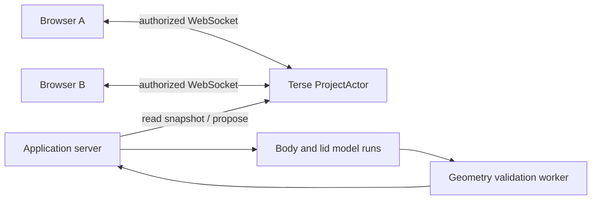

# Architecture and implementation contract

## User experience

Large central viewport, left assembly tree, right shared instructions and agent activity. A compact dimension inspector supports genuine human edits. Each proposal names its author, affected parts, base revision, and status. Show previews separately from accepted geometry. A second browser has its own camera and selection but the same accepted assembly and activity.

## Geometry choice

Use Replicad's JavaScript API over OpenCascade WASM. It already exposes solid modeling and STEP export and has an official browser integration example. Three.js displays meshes; it is not the CAD kernel. Direct OpenCascade bindings add unnecessary integration work for this deadline; a Python CAD service adds another deployment boundary.

Represent each part as a small typed feature specification: boxes, cylinders, extrusion where needed, union/subtraction, transforms, and named dimensions in millimeters. The model composes these operations; there is no prompt classifier or preselected answer. Start with that tool vocabulary and extend it only when the demo needs an operation. Fillets are optional because topology changes can make them fragile.

Use stable application part/feature IDs. Do not identify persistent features by mesh triangle index. Keep PCB dimensions, clearances, wall thickness, and lid overlap in an explicit shared interface record. The AI chooses design changes and records the parameters it read.

Compile geometry in a worker for browser responsiveness. For accepted AI proposals, run authoritative geometry validation in a server-side worker using the same compiler; prove WASM support on the selected host early. Do not evaluate arbitrary model-authored JavaScript. A typed feature interpreter invokes the supported kernel operations.

## Collaboration

One ProjectActor per shared assembly. Persist the accepted specification, monotonic revision, bounded operation history, proposal records, and request IDs. Presence and cursors are transient. Persist model job state separately where supported; never hold the project actor's serialized handler open during inference or geometry compilation.

MVP workers may run concurrently in the application server, with durable pending/finished status in the project actor. A distinct Terse actor per specialist is an extension only after the main path works. Do not claim model calls resume automatically after server failure unless recovery is actually implemented and tested.

## Proposal protocol

1. Human or model reads snapshot at revision N.
2. Model returns a structured proposal with stable part IDs, operations, rationale, and the exact base revision.
3. Validate schema and compile the candidate geometry outside the project actor. Tag the validation result with the candidate hash and base revision.
4. In one short serialized actor operation, check request ID, authorization, validation identity, and current revision.
5. If the current revision is still N, atomically accept and increment it. Persist before advertising acceptance, using the installed SDK's supported transaction mechanism.
6. If stale, do not overwrite or silently merge. Return the latest snapshot and change history to the model for a revised proposal and fresh validation. Two disjoint proposals may still require one regeneration in the MVP; correctness beats a rushed merge engine.
7. Broadcast the accepted revision. Reconnecting clients obtain the latest full snapshot. Reject duplicate request IDs without applying the operation again.

Human dimension edits use the same acceptance path. Multi-part changes commit as one proposal. No last-writer-wins overwrite of the whole document and no heuristic semantic merge. Bounded model repair attempts expose a useful error if they exhaust their budget.

## Model tools

- Read assembly and shared interface dimensions.
- Read accepted changes since a revision.
- Propose part operations against a revision.
- Compile candidate and inspect kernel errors, bounds, and available measurements.
- Publish a short user-facing status explaining the proposed change.

Body and lid agents receive distinct responsibilities and the same dimensional interface. They may run concurrently. On a changed interface, each re-reads and revises its work. A coordinator model is optional; the user can assign the two roles directly for the MVP.

## Validation boundaries

Schema, finite dimensions, kernel construction, nonempty solids, and revision consistency are required. Only show clearance/collision claims when the corresponding geometric test exists. A bounding-box check is not proof of general fit. Demonstrate an actual measured lid/body interface or describe fit as unverified. Do not label the output manufacturing-ready.

The browser receives temporary authorized socket access from the application server; Terse API keys and model credentials remain server-side. A share link grants room access for the demo, not global actor access. Confirm socket grants and actor metadata behavior against the installed SDK.

## Acceptance checks

- Two real clients receive the same accepted revision after a human dimension edit.
- A stale AI proposal cannot erase a more recent human edit.
- Duplicate operation delivery does not apply twice.
- Invalid geometry leaves the accepted assembly unchanged and reports an error.
- Reload and actor restart recover the accepted assembly; test both separately.
- Export produces a STEP file that reopens with the expected geometry.
- No production secret appears in the frontend bundle.

Deployment target: Terse Cloud for actors; a host supporting the chosen server/worker runtime for model orchestration and geometry; static hosting for the frontend. Select after the initial smoke test. Sites can host the frontend, but its Worker runtime must not be assumed sufficient for the CAD worker without testing memory/runtime limits.
