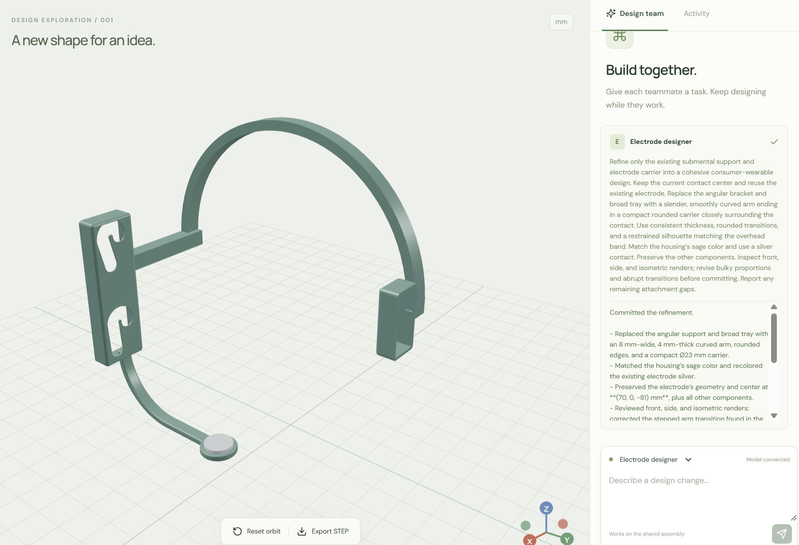

# Wearable redesign example

| File | Contents |
|---|---|
| [original.step](original.step) | The founder's original wearable, eight named exact solid bodies. |
| [refined.step](refined.step) | Real accepted revision 8: overhead band, reused modules, curved submental support, and silver contact; five solids. |
| [run-notes.json](run-notes.json) | Actual prompts and model replies, including the refinement turn. |

Import either STEP into a **fresh room** to inspect and edit it. Import appends bodies; it does not reset the room. The reviewed result is an example artifact, not a deterministic output promised for a prompt.

The input hardware was supplied by the founder and predates the hackathon. Assembly application code was created during the hackathon. STEP contains solids, not the original Fusion modeling timeline. The models are not validated for manufacturing, human fit, or electrode performance.

